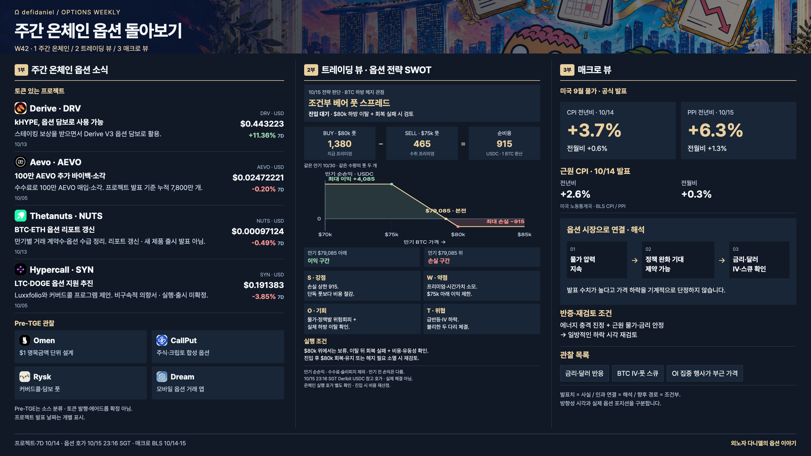

# 외노자 다니엘의 옵션 이야기

**주간 온체인 옵션 돌아보기** — 옵션 프로토콜에 집중하는 콘텐츠 작업실입니다.
텔레그램용 한국어, X용 영어 글과 한·영 원페이저, 옵션 손익 도표를 한 화면에서 확인하고 복사·다운로드할 수 있습니다.



## 링크로 바로 열기

[콘텐츠 작업실 실행](https://digitaldanie1.github.io/optioncontent/) — 원본 로컬 HTML과 같은 페이지입니다. GitHub 저장소의 파일 미리보기 대신 이 링크를 사용하세요.

원고 저장은 접속한 브라우저에만 적용됩니다. 로컬 파일에서 저장한 초안이 웹으로 자동 이동하지는 않습니다.

## 다른 맥북에서 열기

```sh
git clone https://github.com/DigitalDanie1/optioncontent.git
cd optioncontent
open index.html
```

Git이 없다면 GitHub의 **Code → Download ZIP**으로 받아 압축을 풀고 `index.html`을 여세요. `assets`와 `sources` 폴더를 함께 유지하세요. 사이트 열기에 설치나 API 키는 필요 없습니다.

브라우저에서 이미지 복사가 제한되면 PNG 다운로드를 사용하세요. 작성 중인 글은 브라우저 로컬 저장소에 저장되며 기기 간 자동 동기화되지 않습니다. 수정한 파일은 Git으로 commit/push해야 다른 맥북에서도 받을 수 있습니다. 이후 업데이트는 `git pull`로 받습니다.

## 바로 사용하는 파일

| 용도 | 파일 |
| --- | --- |
| 콘텐츠 작업실 | [index.html](index.html) |
| 한국어 이미지 | [weekly-options-W42-ko.png](assets/images/weekly-options-W42-ko.png) |
| 영어 이미지 | [weekly-options-W42-en.png](assets/images/weekly-options-W42-en.png) |
| 한·영 이미지 묶음 | [weekly-options-W42-ko-en.zip](assets/weekly-options-W42-ko-en.zip) |
| 텔레그램 한국어 글 | [telegram-three-parts-W42.txt](assets/telegram-three-parts-W42.txt) |
| X 영어 글 | [x-three-parts-W42.txt](assets/x-three-parts-W42.txt) |
| 손익 그래프·슬라이더 | [bear-put-spread-payoff.html](assets/bear-put-spread-payoff.html) |
| 지난 회차 영상 W41 | [weekly-onchain-options-W41.mp4](assets/weekly-onchain-options-W41.mp4) |

1. **주간 온체인:** 토큰 프로젝트 소식과 Pre-TGE 관찰 목록.
2. **트레이딩 뷰:** 조건부 전략, SWOT, 만기 손익 도표.
3. **매크로 뷰:** 발표된 수치, 옵션 시장에 대한 해석과 재검토 조건.

기존 회차 이미지와 ZIP은 이전 자료 다운로드 호환성을 위해 `assets`에 보관했습니다. **현재 대표 파일은 위 W42 한·영 이미지와 글**입니다.

## 자료 기준일과 출처

이 저장소는 **2026-W42 저장본**이며 실시간 시세판이 아닙니다.

- 프로젝트 가격·7D 거래량: 2026-10-14 16:59 SGT.
- 펀더멘털·전략 지표: 2026-10-15 16:33~16:35 SGT.
- 베어 풋 스프레드 참고 호가: 2026-10-15 23:16 SGT.
- 프로젝트 소식은 개별 발표일을 표시합니다. 일부는 10/5 발표입니다.
- W41 영상은 이전 회차이며 W42 데이터로 갱신된 영상이 아닙니다.

기준 소스는 [OPSHNZ](https://opshnz.com/#/home), 프로젝트 공식 발표 및 BLS입니다. 저장한 데이터와 개별 근거는 [sources](sources)에 있습니다. 거래량은 소스의 집계 범위와 기간에 한정됩니다. Pre-TGE 분류는 토큰 발행·에어드롭 확정이 아닙니다.

트레이딩 뷰의 전략은 **현재 진입 대기**인 조건부 사례입니다. Deribit USDC 참고 호가로 계산했으며 온체인 체결 호가가 아닙니다. 1 BTC 환산 순비용 915 USDC, 만기 최대 손실 915, 최대 이익 4,085, 손익분기 BTC $79,085이며 수수료·슬리피지는 제외합니다. 만기 전 손익과 실제 체결가는 다릅니다.

## 수정과 이미지 재생성

- 페이지·복사 글: `index.html`의 `weekly-data` JSON 및 관련 HTML을 수정합니다.
- 배포용 텍스트: `assets/*-W42.txt`도 함께 갱신합니다.
- 이미지 원본: `scripts/weekly-ko-W42.html`, `scripts/weekly-en-W42.html`입니다. 두 언어의 수치·날짜를 함께 수정하세요.
- 다음 회차에는 파일명, 날짜, 출처, 페이지의 다운로드 링크와 JSON 이미지 경로도 함께 바꾸세요.

선택적으로 Node.js 22+에서 원페이저를 재생성할 수 있습니다.

```sh
npm install
npx playwright install chromium
npm run render
python3 scripts/check.py
```

`npm run render`는 이미지 두 장을 덮어씁니다. 기존 ZIP 묶음은 자동 갱신하지 않으므로 이미지 수정 후 다시 묶으세요. `npm install` 없이도 완성된 페이지와 이미지·영상은 볼 수 있습니다.

## X / Grok 자료 수집 (선택)

[project-x-accounts.json](project-x-accounts.json)에 옵션 프로젝트 49개 중 X 계정 48개가 등록되어 있습니다. Hunch의 공식 계정은 미확인입니다.

`collect-x-grok.mjs`는 등록 계정을 나눠 xAI X Search를 호출하고 결과를 `x-collection/`에 저장합니다. **이 저장본에서는 실제 API 수집을 실행하지 않았습니다.** 검색은 전체 타임라인 수집을 보장하지 않으며 게시 전 원문 URL·날짜·저자를 확인해야 합니다. 자동 게시 기능은 없습니다.

```sh
# Node.js 22+; 키는 로컬 환경변수로만 설정
read -s XAI_API_KEY
export XAI_API_KEY
node collect-x-grok.mjs 2026-10-12 2026-10-18
unset XAI_API_KEY
```

시작일·종료일은 UTC 날짜이며 종료일을 포함합니다. 유료 API 호출입니다. 기본 모델은 스크립트에 지정되어 있으며 `XAI_MODEL` 환경변수로 변경할 수 있습니다. 계정 접근 권한과 현재 모델 지원은 실행 시 확인하세요. API 키를 HTML, 소스 파일, Git에 넣지 마세요.

공식 문서: [xAI X Search](https://docs.x.ai/developers/tools/x-search).
